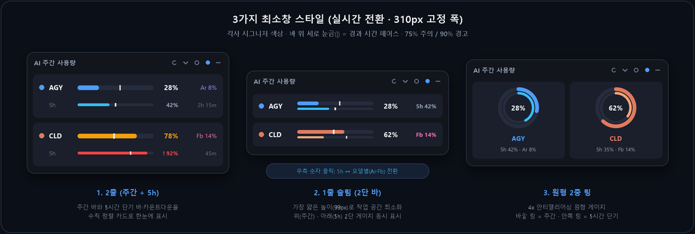
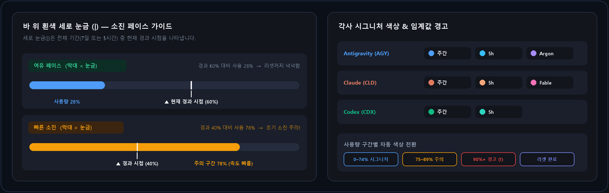
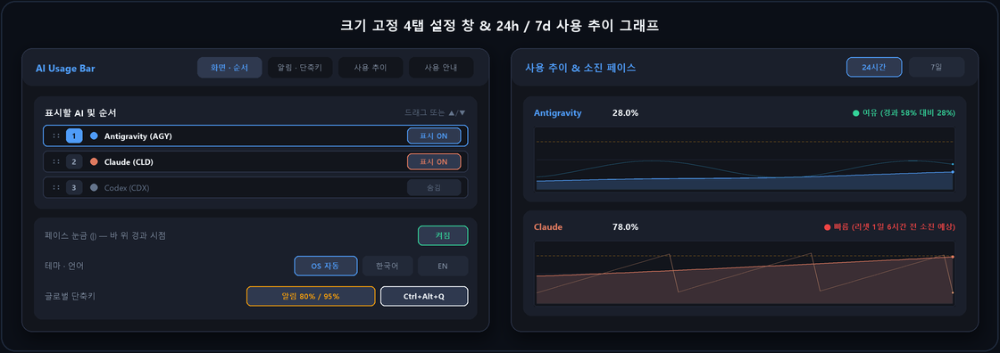

# AI Usage Bar

<p align="center">
  <a href="README.md">English</a> | <strong>한국어</strong>
</p>

<p align="center">
  <strong>Antigravity · Claude · Codex</strong>의 주간(7일) / 단기(5시간) 사용량(또는 남은량 %), 리셋 카운트다운, 소진 페이스(Pace) 눈금, 24h/7d 사용 추이를<br/>
  작업표시줄 위 항상 최상위 미니 위젯과 시스템 트레이로 표시해 주는 유틸리티입니다. (<strong>사용량 차감 없음 · Windows Python 설치 불필요</strong>)
</p>

<p align="center">
  
</p>

---

## 바 위 흰색 세로 눈금(`|`) & 각사 시그니처 색상 안내

<p align="center">
  
</p>

- **바 위 세로 눈금 (`|`):** 전체 기간(7일 또는 5시간) 중 **현재 경과한 시간 위치**를 표시합니다.
  - **막대가 눈금보다 짧을 때:** 여유 페이스 — 리셋까지 여유롭게 사용 중입니다.
  - **막대가 눈금을 넘겼을 때:** 빠른 소진 — 최소창 행/원형에 마우스를 올리거나 **`사용 추이`** 탭에서 조기 소진 예상 시간을 확인할 수 있습니다.
- **각사 시그니처 색상 & 임계값 경고:** 각 AI와 5시간 바, Argon/Fable 모델별 한도를 고유 시그니처 색상으로 구분하며, 사용량 **75%+ 주의(주황)** · **90%+ 경고 `⚠`(빨강)**로 자동 전환됩니다.

---

## 크기 고정 4탭 설정 창 & 24h / 7d 사용 추이 그래프

<p align="center">
  
</p>

- **3가지 최소창 스타일 & 실시간 미리보기:** **2줄 (주간+5h)** · **1줄 슬림 (우측 클릭 `5h↔모델별`)** · **원형 2중 링**을 클릭 한 번으로 즉시 전환합니다.
- **드래그 앤 드롭 AI 순서 커스텀:** `⠿` 핸들을 위아래로 드래그(또는 `▲/▼`)하면 최소창·원형 링·상세 보기·트레이 아이콘 순서가 실시간으로 반영됩니다.
- **수동 커스텀 알림 & 글로벌 단축키:** 주의(`60%~90%`), 임박(`85%~98%`), 알림 범위(`주간+5시간` / `주간만`), 리셋 완료 알림을 개별 설정하고, 원하는 조합키(기본 `Ctrl+Alt+Q`)를 직접 녹화해 어느 창에서든 위젯을 숨기거나 띄울 수 있습니다.
- **한국어 / English 실시간 전환 & 다크/라이트 자동 테마:** OS 언어와 다크/라이트 테마를 자동 감지하며 설정 창에서 1클릭 전환을 지원합니다.

---

## 사용량 차감 없는 자동 갱신 동작 방식

비공식 내부 API 호출이나 OAuth 토큰 추출 없이 **공식 CLI(`agy`, `claude`, `codex`)와 공식 `statusLine` 훅만 안전하게 사용**합니다.


- 데스크톱 앱·웹만 사용해도 백그라운드에서 **프롬프트 전송·사용량 차감 없이** 자동 갱신됩니다.
- 5분 이상 키보드/마우스 입력이 없으면 백그라운드 조회를 쉬고, 복귀 시 즉시 최신 값을 불러옵니다.

---

## 설치 방법

### Windows 10 / 11 (Python 설치 불필요)
1. [Releases](../../releases)에서 **`AIUsageBar-Setup.exe`**를 다운로드해 실행합니다.
2. 설치 마법사(우측 상단 `[한국어 | EN]` 전환 지원)가 PC 환경을 자동 감지하고 기존 설정을 백업한 뒤 `AIUsageBar.exe` + 무콘솔 네이티브 `quota_hook.exe` 및 공식 `statusLine` 훅을 설치합니다.
3. 아래 안내에 따라 사용하는 CLI에 최초 1회 로그인을 완료합니다.

### macOS (Apple Silicon / Intel)
- [Releases](../../releases)에서 **`AIUsageBar-macOS.dmg`**를 다운로드하거나, 소스 폴더의 `./macos/install_macos.command`를 실행하세요.
- 자세한 내용은 [`macos/README_macOS.md`](macos/README_macOS.md)를 참고하세요.

---

## CLI 최초 로그인 & 문제 해결 가이드

**Claude 데스크톱/웹**이나 **Antigravity 앱**만 주로 사용하시더라도, AI Usage Bar는 공식 CLI(`claude`, `agy`, `codex`)를 통해 사용량 차감 없이 실시간 한도를 조회합니다. 사용하는 AI별로 아래 1회 로그인만 해두시면 됩니다.

### 1. Claude (`claude`) — Pro / Max 구독 계정
1. 일반 작업 폴더에서 터미널을 열고 `claude`를 실행합니다.
2. 폴더 신뢰 확인(*"Do you trust the files in this folder?"*)이 뜨면 1회 허용합니다. (백그라운드 `/usage` 조회가 안전하게 동작하는 데 필요합니다.)
3. Claude Code 안에서 `/login`을 입력하고 **반드시 `Claude account with subscription`**을 선택해 로그인합니다.
   - *(주의: Console / `API Usage Billing` 계정은 종량제 방식이라 5시간·주간 구독 한도가 표시되지 않습니다.)*
4. **사용 중 Claude 수치가 업데이트되지 않을 때** (CLI 자동 업데이트나 OAuth 세션 만료로 로그인이 풀린 경우, 또는 위젯에 `⚠ Claude Pro/Max 로그인 필요 (/login)` 경고가 뜰 때):
   - 터미널에서 `claude auth status`를 실행해 `"loggedIn": true`인지 확인합니다.
   - 로그인이 풀려 있다면 터미널에서 `claude` → `/login` → **`Claude account with subscription`** 선택으로 1회 복구한 뒤 위젯의 `↻` 버튼을 누르면 바로 갱신됩니다.

### 2. Antigravity (`agy`)
1. 공식 `agy` CLI를 설치합니다. (Windows 설치 마법사에서 자동 설치 체크 가능, 또는 PowerShell에서 `irm https://antigravity.google/cli/install.ps1 | iex` 실행)
2. 터미널에서 `agy`를 1회 실행하고 Google 계정으로 로그인합니다. (로그인 후 공식 `statusLine` 훅을 통해 주간 · Argon · 5시간 한도가 자동 반영됩니다.)
3. **Antigravity가 `대기중`에 머물거나 갱신이 멈출 때:**
   - 터미널에서 `agy`를 실행해 Google 로그인이 유지되어 있는지 확인합니다(재로그인 안내가 뜨면 로그인 진행).
   - 다른 도구가 CLI의 `statusLine` 설정을 덮어썼다면 위젯의 **설정 (`⚙`) → 알림 · 단축키 → `⚡ 훅 재연결`**을 누른 뒤 `↻`로 새로고침합니다.

### 3. Codex (`codex`, 선택 사항)
- **설정 (`⚙`) → 화면 · 순서 → 표시할 AI 및 순서**에서 **Codex**를 켤 수 있습니다.
- 공식 `codex` CLI에 로그인해 두거나, 로컬에서 Codex를 사용하면 `~/.codex/sessions/**/*.jsonl` 세션 기록의 한도 정보를 자동으로 읽어 표시합니다.

---

## 개발자용 빌드 방법

### Windows (`AIUsageBar-Setup.exe`)
```powershell
pip install pillow pyinstaller
python build_release.py
```

### macOS (`AIUsageBar.app` 및 `AIUsageBar-macOS.dmg`)
```bash
pip install pillow pyinstaller
python3 macos/build_macos.py
```

### GitHub Actions 자동 릴리스
버전 태그(`git tag v1.8.2 && git push origin v1.8.2`)를 푸시하면 [`.github/workflows/release.yml`](.github/workflows/release.yml)가 Windows용 `AIUsageBar-Setup.exe`와 macOS용 `AIUsageBar-macOS.dmg`를 자동 빌드해 GitHub Releases에 첨부합니다.

---

## 라이선스

Copyright (c) 2026 hugree.  
[GNU General Public License v3.0 (GPL-3.0)](LICENSE)를 따릅니다.  
개인·회사 업무용 모두 무료로 사용할 수 있으며, 소스를 수정해 재배포하는 경우 원작자 저작권 표기를 유지하고 동일한 GPL-3.0 라이선스로 전체 소스를 공개해야 합니다.
