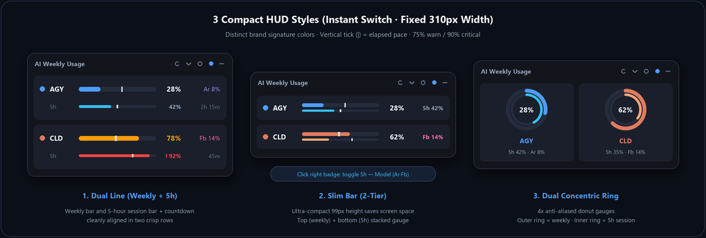
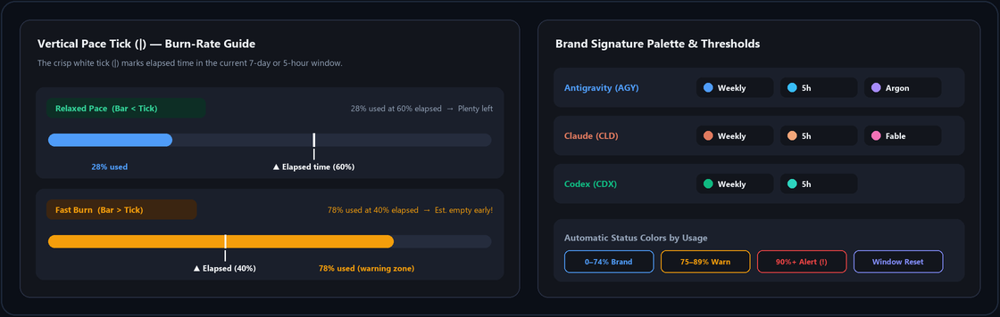
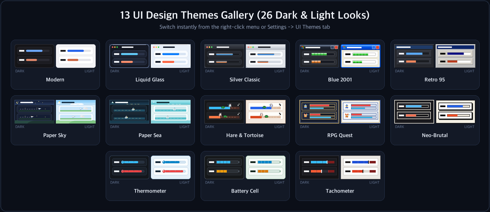
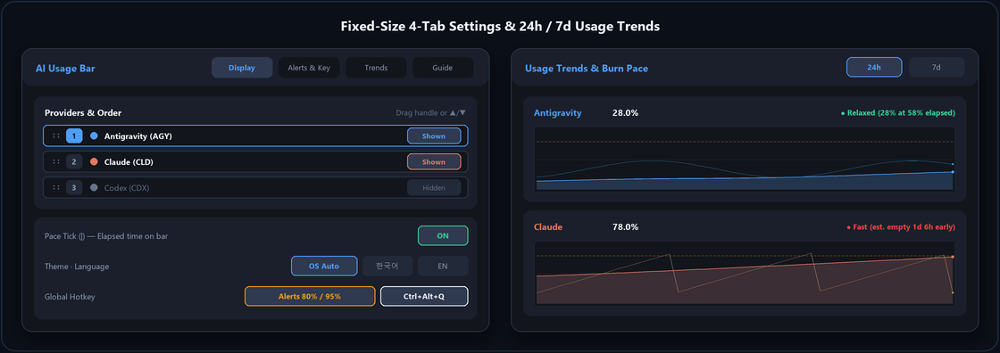
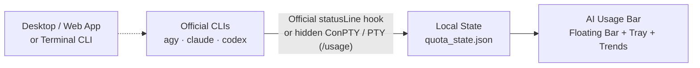

# AI Usage Bar

<p align="center">
  <strong>English</strong> | <a href="README.ko.md">한국어</a>
</p>

<p align="center">
  Always-on-top mini floating HUD &amp; native system tray monitor for <strong>Antigravity</strong>, <strong>Claude</strong>, and <strong>Codex</strong>.<br/>
  Track weekly (7-day) &amp; short-term (5-hour) quotas, reset countdowns, elapsed-time burn pace, and 24h/7d usage trends — with <strong>zero quota deducted</strong> and <strong>no Python required</strong> on Windows.
</p>

<p align="center">
  
</p>

---

## Reading the Pace Tick (`|`) & Brand Signature Colors

<p align="center">
  
</p>

- **Vertical white tick (`|`):** Marks how much of the current window (7 days or 5 hours) has elapsed.
  - **Bar shorter than `|`:** Relaxed pace — you're well under budget.
  - **Bar past `|`:** Burning fast — hover any row/ring or open **Trends** to see the estimated early-depletion forecast.
- **Distinct brand signature palette:** Each provider keeps its own signature color (plus a distinct 5h sub-tone and Argon/Fable model color) until **75%+** (amber warning) and **90%+** (crimson critical with `⚠`).

---

## 13 UI Design Themes Gallery (26 Dark & Light Looks)

<p align="center">
  
</p>

More than simple color swaps — every theme reshapes **window chrome, titlebars, progress gauges, dual rings, and icons**. Each of the **13 UI themes** ships with hand-tuned **Dark & Light** palettes and switches instantaneously from the **right-click → UI Themes** menu or **Settings (`⚙`) → UI Themes** gallery:

| Theme | Style & Visual Highlights |
|---|---|
| **Modern** | Clean elevated cards with smooth capsule progress bars |
| **Liquid Glass** | Frosted specular glass rims, crystal traffic dots & refractive glass pills |
| **Silver Classic** | Brushed aluminum titlebar, 3D jewel traffic dots & glossy gel bars |
| **Blue 2001** | 2001 nostalgia glossy blue titlebar, red X button & 3D green segmented blocks |
| **Retro 95** | 1995 classic desktop window with navy titlebar & raised 3D bevel cards |
| **Paper Sky** | Watercolor summer sky, meadow hills & gliding paper airplane *(Dark: starry night)* |
| **Paper Sea** | Sunlit watercolor ocean ripples & drifting paper sailboat *(Dark: moonlit lantern)* |
| **Hare & Tortoise** | Your usage (Hare) races against recommended time pace (Tortoise) on a clay track |
| **RPG Quest** | Mood-reactive pixel heroes, Royal Navy/Ivory frames & HP (7d) / MP (5h) bars |
| **Neo-Brutal** | Bold 2px ink borders with crisp 3px hard offset shadows |
| **Thermometer** | Glass mercury bulb, `°C` scale ticks & heat-reactive boiling bubbles |
| **Battery Cell** | Physical battery housing with `+` metal terminal & glowing charge cells |
| **Tachometer** | Sports car RPM gauge with crimson redline (`75%+`) & radial needle |

---

## Fixed-Size 5-Tab Settings & 24h / 7d Usage Trends

<p align="center">
  
</p>

- **3 Compact Styles with Live Previews:** Switch instantly between **Dual Line**, **Slim Bar** (click right badge to toggle `5h ↔ Ar/Fb`), and **Dual Ring**.
- **Drag-and-Drop Provider Ordering:** Drag the `⠿` handle (or click `▲/▼`) to reorder **Antigravity**, **Claude**, and **Codex** across the HUD, ring cards, detail view, and tray icon in real time.
- **Custom Alerts & Global Hotkey:** Set warning (`60%–90%`) and critical (`85%–98%`) thresholds, scope (`Weekly + 5h` or `Weekly Only`), reset alerts, and record any global show/hide hotkey (default `Ctrl+Alt+Q`).
- **Bilingual UI (EN / KO) & Auto OS Theme:** Detects OS language and Windows/macOS Dark/Light theme automatically, with instant 1-click switching in Settings.

---

## How Zero-Deduction Auto-Refresh Works

AI Usage Bar **never calls undocumented internal APIs** and **never extracts OAuth tokens**. It only talks to official CLIs (`agy`, `claude`, `codex`) and their official `statusLine` hooks:



- Works even if you only use desktop or web apps — silently refreshes in a hidden console with **zero prompts and zero quota deducted**.
- Automatically pauses background polling after **5 minutes of inactivity** and refreshes as soon as you return.

---

## Installation

### Windows 10 / 11 (No Python Required)
1. Download **`AIUsageBar-Setup.exe`** from [Releases](../../releases) (or build locally with `python build_release.py`).
2. Run the Setup Wizard — auto-detects English/Korean (with a `[한국어 | EN]` toggle in the header), installs `AIUsageBar.exe` + the lightweight zero-console native `quota_hook.exe`, and connects official `statusLine` hooks after backing up your existing configs.
3. Complete the one-time CLI sign-in below for each provider you want to monitor.

### macOS (Apple Silicon / Intel)
- **DMG (Apple Silicon):** Download **`AIUsageBar-macOS.dmg`** from [Releases](../../releases), drag `AIUsageBar.app` into `Applications`, and run `xattr -cr /Applications/AIUsageBar.app` once in Terminal if macOS Gatekeeper blocks the unsigned open-source build.
- **From Source (Apple Silicon & Intel, no Gatekeeper prompt):** Run `./macos/install_macos.command`.
- See [`macos/README_macOS.md`](macos/README_macOS.md) for details.

---

## CLI Sign-In & Troubleshooting Guide

Even if you mainly use the **Claude Desktop / Web** or **Antigravity Desktop** apps, AI Usage Bar reads live quotas through the official CLIs (`claude`, `agy`, `codex`) with zero usage deducted. Complete this one-time sign-in per provider:

### 1. Claude (`claude`) — Pro / Max Subscription
1. Open a terminal in any normal project folder and run `claude`.
2. If prompted with *"Do you trust the files in this folder?"*, accept it once (required so silent `/usage` checks work in a trusted folder).
3. Run `/login` inside Claude Code and **be sure to select `Claude account with subscription`** (not Console / API Usage Billing, which does not expose 5-hour or 7-day subscription quotas).
4. **If Claude stops updating later** (e.g., after a Claude Code CLI auto-update or OAuth session expiry, or if the widget shows `⚠ Claude Pro/Max sign-in required (/login)`):
   - Check status with `claude auth status` (should show `"loggedIn": true`).
   - Run `claude` → `/login` → select **`Claude account with subscription`** once to restore live syncing, then click `↻` on the widget.

### 2. Antigravity (`agy`)
1. Install the official `agy` CLI (the Windows Setup Wizard can install it automatically, or run `irm https://antigravity.google/cli/install.ps1 | iex` in PowerShell).
2. Run `agy` once in a terminal and sign in with your Google account.
3. **If Antigravity stays on `Waiting` or stops updating:**
   - Run `agy` in a terminal to confirm your Google login is active (if prompted to sign in again, re-authenticate).
   - If another tool overwrote your CLI `statusLine` config, open **Settings (`⚙`) → Alerts & Key → `⚡ Reconnect Hooks`**, then click `↻`.

### 3. Codex (`codex`, Optional)
- Enable **Codex** in **Settings (`⚙`) → Display → Providers & Order**.
- Sign in to the official `codex` CLI (or simply use Codex — AI Usage Bar automatically reads rate limits from local `~/.codex/sessions/**/*.jsonl` session logs as a fallback).

---

## Building from Source

### Windows (`AIUsageBar-Setup.exe`)
```powershell
pip install pillow pyinstaller
python build_release.py
```

### macOS (`AIUsageBar.app` & `AIUsageBar-macOS.dmg`)
```bash
pip install pillow pyinstaller
python3 macos/build_macos.py
```

### Automated Releases (GitHub Actions)
Pushing a version tag (e.g. `git tag v1.8.6 && git push origin v1.8.6`) automatically builds both **`AIUsageBar-Setup.exe`** (Windows) and **`AIUsageBar-macOS.dmg`** (macOS) via [`.github/workflows/release.yml`](.github/workflows/release.yml) and publishes them to GitHub Releases.

---

## License

Copyright (c) 2026 hugree.  
Released under the [GNU General Public License v3.0 (GPL-3.0)](LICENSE).  
Free to use for personal and workplace use; any modified redistribution must remain open source under GPL-3.0 with original copyright attribution intact.
