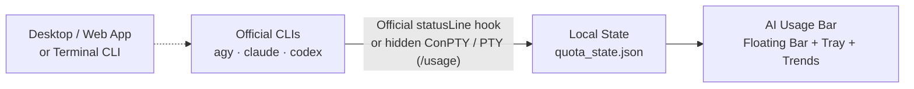

# AI Usage Bar

<p align="center">
  <strong>English</strong> | <a href="README.ko.md">한국어</a>
</p>

<p align="center">
  Always-on-top mini floating HUD &amp; native system tray monitor for <strong>Antigravity</strong>, <strong>Claude</strong>, and <strong>Codex</strong>.<br/>
  Track weekly (7-day) &amp; short-term (5-hour) quotas, reset countdowns, elapsed-time burn pace, and 24h/7d usage trends — with <strong>zero quota deducted</strong> and <strong>no Python required</strong> on Windows.
</p>

<p align="center">
  
</p>

---

## Reading the Pace Tick (`|`) & Brand Signature Colors

<p align="center">
  
</p>

- **Vertical white tick (`|`):** Marks how much of the current window (7 days or 5 hours) has elapsed.
  - **Bar shorter than `|`:** Relaxed pace — you're well under budget.
  - **Bar past `|`:** Burning fast — hover any row/ring or open **Trends** to see the estimated early-depletion forecast.
- **Distinct brand signature palette:** Each provider keeps its own signature color (plus a distinct 5h sub-tone and Argon/Fable model color) until **75%+** (amber warning) and **90%+** (crimson critical with `⚠`).

---

## Fixed-Size 4-Tab Settings & 24h / 7d Usage Trends

<p align="center">
  
</p>

- **3 Compact Styles with Live Previews:** Switch instantly between **Dual Line**, **Slim Bar** (click right badge to toggle `5h ↔ Ar/Fb`), and **Dual Ring**.
- **Drag-and-Drop Provider Ordering:** Drag the `⠿` handle (or click `▲/▼`) to reorder **Antigravity**, **Claude**, and **Codex** across the HUD, ring cards, detail view, and tray icon in real time.
- **Custom Alerts & Global Hotkey:** Set warning (`60%–90%`) and critical (`85%–98%`) thresholds, scope (`Weekly + 5h` or `Weekly Only`), reset alerts, and record any global show/hide hotkey (default `Ctrl+Alt+Q`).
- **Bilingual UI (EN / KO) & Auto OS Theme:** Detects OS language and Windows/macOS Dark/Light theme automatically, with instant 1-click switching in Settings.

---

## How Zero-Deduction Auto-Refresh Works

AI Usage Bar **never calls undocumented internal APIs** and **never extracts OAuth tokens**. It only talks to official CLIs (`agy`, `claude`, `codex`) and their official `statusLine` hooks:



- Works even if you only use desktop or web apps — silently refreshes in a hidden console with **zero prompts and zero quota deducted**.
- Automatically pauses background polling after **5 minutes of inactivity** and refreshes as soon as you return.

---

## Installation

### Windows 10 / 11 (No Python Required)
1. Download **`AIUsageBar-Setup.exe`** from [Releases](../../releases) (or build locally with `python build_release.py`).
2. Run the Setup Wizard — auto-detects English/Korean (with a `[한국어 | EN]` toggle in the header), installs `AIUsageBar.exe` + the 17 KB native `quota_hook.exe`, and connects official `statusLine` hooks after backing up your configs.
3. Sign in once to each CLI you use:
   - **Antigravity:** run `agy` once in terminal and sign in with Google.
   - **Claude:** run `claude` → `/login` and choose **Claude account with subscription** (Pro/Max).
   - **Codex (optional):** install/sign in to `codex` CLI or let the HUD read local session logs.

### macOS (Apple Silicon / Intel)
- Download **`AIUsageBar-macOS.dmg`** from [Releases](../../releases), or run `./macos/install_macos.command` directly from source.
- See [`macos/README_macOS.md`](macos/README_macOS.md) for details.

---

## Building from Source

### Windows (`AIUsageBar-Setup.exe`)
```powershell
pip install pillow pyinstaller
python build_release.py
```

### macOS (`AIUsageBar.app` & `AIUsageBar-macOS.dmg`)
```bash
pip install pillow pyinstaller
python3 macos/build_macos.py
```

### Automated Releases (GitHub Actions)
Pushing a version tag (e.g. `git tag v1.8.0 && git push origin v1.8.0`) automatically builds both **`AIUsageBar-Setup.exe`** (Windows) and **`AIUsageBar-macOS.dmg`** (macOS) via [`.github/workflows/release.yml`](.github/workflows/release.yml) and publishes them to GitHub Releases.

---

## License

Copyright (c) 2026 hugree.  
Released under the [GNU General Public License v3.0 (GPL-3.0)](LICENSE).  
Free to use for personal and workplace use; any modified redistribution must remain open source under GPL-3.0 with original copyright attribution intact.
